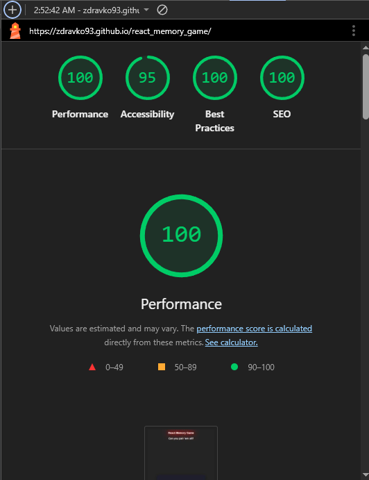

# React Memory Game

A responsive, interactive memory card game built with **React** and **JavaScript**. Test your memory by matching card pairs, tracking your moves, and playing across different difficulty levels.

🔗 **GitHub Repository**: https://github.com/Zdravko93/react_memory_game
🔗 **Live Demo**: https://zdravko93.github.io/react_memory_game/


## Table of Contents

- [Overview](#overview)
- [Features](#features)
- [Technical Overview](#technical-overview)
- [Performance & Accessibility](#performance--accessibility)
  - [Lighthouse Report](#lighthouse-report)
- [Technologies Used](#technologies-used)
- [Getting Started](#getting-started)
  - [Prerequisites](#prerequisites)
  - [Installation](#installation)
- [Future Enhancements](#future-enhancements)
- [Author](#author)

## Overview

React Memory Game is a browser-based card matching game developed to strengthen my understanding of React, component architecture, and state management.

The game challenges players to find matching card pairs while keeping track of their moves. It features dynamic card shuffling, multiple difficulty levels, interactive gameplay, and responsive layouts for different screen sizes.

### Features

- Dynamic Card Shuffling: Cards are shuffled whenever a new game starts.
- Interactive Gameplay: Flip cards using mouse clicks or keyboard controls (Enter and Space).
- Move Tracking: Keep track of the number of moves made during a game.
- Game Log: View a log of player turns.
- Difficulty Levels: Change the difficulty level, including during an active game.
- Game Controls: Restart the game at any time or start a new game after matching all pairs.
- Animations: Visual feedback for card flips and successfully matched pairs.
- Responsive Design: Optimized layouts for desktop, tablet, and mobile devices.


### Screenshot


## Technical Overview

The project focuses on implementing interactive game logic using React's state management capabilities.

Key implementation areas include:

- State Management: Using useReducer to manage game state and related actions.
- Side Effects: Using useEffect for handling side effects within the application.
- Game Logic: Implementing card shuffling, pair matching, move tracking, and game resets.
- Component-Based Architecture: Organizing the interface into reusable React components.
- Styling: Using CSS Modules to keep component styles scoped and maintainable.


## Performance & Accessibility

The project was evaluated using Google Lighthouse, achieving the following reported result:

- **Lighthouse Performance Score:** 100
- **Keyboard Interaction:** Supports keyboard controls for flipping cards
- **Responsive Layout:** Adapts to desktop, tablet, and mobile screen sizes
- **SEO & Social Sharing:** Includes meta tags and Open Graph / Twitter Card metadata

### Lighthouse Report




### Technologies Used

- `React`: Building the component-based user interface
- `JavaScript (ES6+)`: Game logic and application functionality
- `useReducer`: Managing application state
- `useEffect`: 	Handling side effects
- `CSS Modules`: Component-scoped styling


## Getting Started

### Prerequisites
   - Node.js v18 or later
   - npm (included with Node.js)

### Installation

1. Clone the repository:
   ```bash
   git clone https://github.com/Zdravko93/react_memory_game.git
   ```
2. Navigate to the project directory:
   ```bash
   cd react_memory_game
   ```
3. Install dependencies:
   ```bash
   npm install
   ```
4. Start the development server:
   ```bash
   npm run dev
   ```
5. Open the local URL displayed in your terminal to access the application

### Future Enhancements

Potential improvements for future iterations include:

- **Enhanced Animations**: Further refine card transitions and game feedback to create a smoother gameplay experience
- **Game Statistics**: Introduce additional performance metrics, such as matching accuracy and final scores

## Author

Github: [Zdravko93](https://github.com/Zdravko93)
Frontend Mentor: [@Zdravko93](https://www.frontendmentor.io/profile/Zdravko93)
